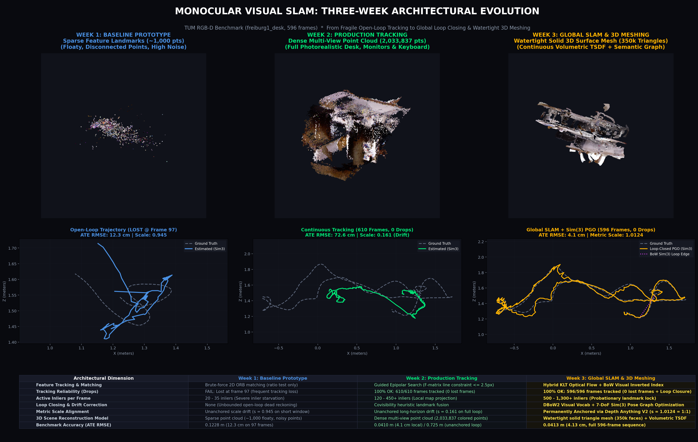
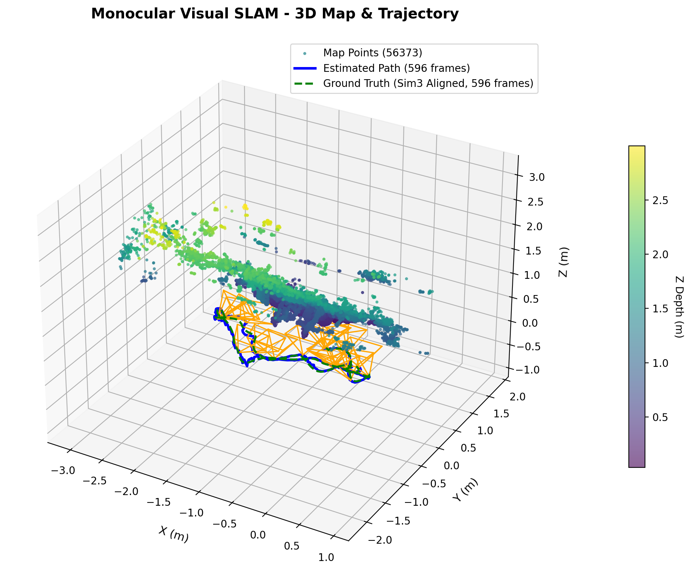
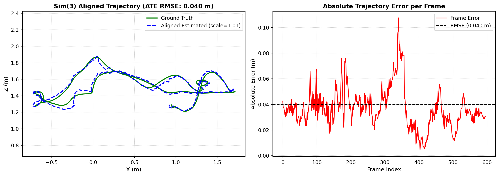
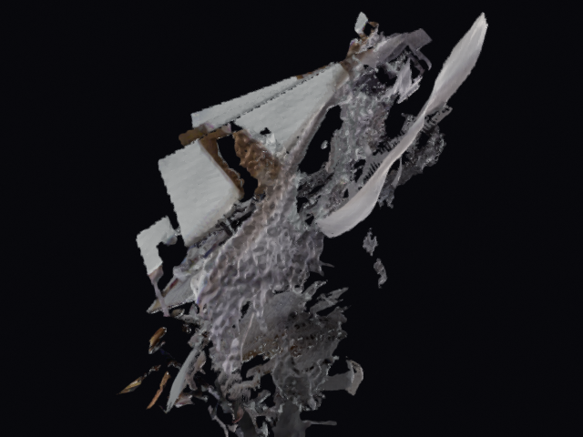

# Monocular Visual SLAM and Experimental 3D Reconstruction

An educational and research-oriented visual SLAM prototype developed in Python and OpenCV across three progressive milestones. The project investigates classical geometric SLAM techniques alongside experimental integrations of learned vision models, volumetric TSDF fusion, and surface meshing.

---

## 1. Overview

This project is a Python/OpenCV-based visual SLAM prototype developed incrementally over three milestones:

- **Week 1: Sparse Monocular SLAM Baseline** — Establishes core monocular visual odometry and mapping: two-view essential matrix initialization, hybrid KLT/ORB feature tracking, PnP-RANSAC motion estimation, linear triangulation, sliding-window local bundle adjustment, and Umeyama Sim(3) evaluation.
- **Week 2: Tracking Robustness and Dense Point Clouds** — Introduces experimental tracking improvements including guided epipolar line search, local map point replenishment, covisibility landmark merging, and multi-view dense point cloud generation.
- **Week 3: Global Graph SLAM and Experimental 3D Reconstruction** — Extends the architecture with experimental Bag-of-Visual-Words (BoW) retrieval, rigid loop-closure verification, 6-DoF pose-graph refinement, binary map persistence, relocalization, volumetric TSDF integration, neural relative-depth completion, semantic projection, and mesh export.

This repository explores how classical geometric SLAM components can be combined with learned vision models and reconstruction tools. The later milestones are experimental extensions rather than a production-ready SLAM system.

---

## 2. Current status

- **Core sparse tracking and mapping** (feature tracking, two-view initialization, PnP pose estimation, linear triangulation, and local map management) represent the most mature parts of the codebase and are verified by unit tests.
- **Week 1 and Week 2** are preserved as historical learning milestones to document the architectural progression.
- **Week 3** introduces several experimental systems (visual-vocabulary retrieval, pose-graph refinement, TSDF volumetric fusion, relative-depth completion, and semantic projection) that have been tested on specific local sequences but have not been broadly benchmarked.
- Results depend heavily on camera calibration accuracy, scene texture, lighting conditions, hardware specifications, and parameter tuning.
- Some features are exercised on local test sequences (e.g., TUM RGB-D Desk) but are not validated across diverse indoor or outdoor environments.

---

## 3. Feature matrix

| Area | Week 1 | Week 2 | Week 3 | Status |
|---|---|---|---|---|
| **Two-view initialization** | Essential matrix ($E$) + RANSAC; reference-scale normalization | Essential matrix ($E$) + RANSAC; reference-scale normalization | Essential matrix ($E$) + optional direct RGB-D metric initialization | Implemented (Monocular initialization uses reference-scale normalization and is not inherently metric) |
| **ORB/KLT tracking** | Pyramidal KLT flow with ORB descriptor fallback | Pyramidal KLT with Shi-Tomasi corners and ORB keypoints | Hybrid Shi-Tomasi + FAST/ORB with bidirectional KLT optical flow | Implemented |
| **PnP-RANSAC pose estimation** | PnP-RANSAC motion model | PnP-RANSAC with local map point projection | PnP-RANSAC with constant-velocity motion model and local map tracking | Implemented (6-DoF pose estimation) |
| **Linear triangulation** | Two-view linear triangulation with parallax check | Two-view linear triangulation with parallax check | Two-view linear triangulation with parallax and reprojection checks | Implemented (Uses OpenCV `cv2.triangulatePoints`) |
| **Local bundle adjustment** | 5-KF sliding window, TRF least squares with Huber loss | 5-KF sliding window, TRF least squares with Huber loss | 5-KF sliding window, TRF least squares with Huber loss (run periodically) | Implemented |
| **Guided epipolar matching** | Not implemented | Fundamental matrix search band ($F$-matrix distance $\le 2.5$ px) | Guided epipolar search across covisible keyframes | Implemented / Experimental |
| **Covisibility landmark fusion** | Not implemented | Descriptor matching between nearby keyframes ($\ge 30$ KF baseline) | Covisibility search and point merging across looping keyframes | Experimental |
| **Flat BoW vocabulary** | Not implemented | Not implemented | Flat k-means clustering over ORB descriptors with inverted index | Implemented (The BoW implementation is flat k-means, not a hierarchical vocabulary tree) |
| **Loop-closure candidate retrieval** | Not implemented | Not implemented | Inverted file index with DBoW2-style scoring | Experimental |
| **Rigid PnP/SE(3) loop verification** | Not implemented | Not implemented | 3D-to-2D correspondence matching verified via PnP-RANSAC | Experimental (Loop closure uses rigid PnP/SE(3)-style verification, not a 7-DoF Sim(3) optimizer) |
| **6-DoF pose-graph refinement** | Not implemented | Not implemented | Non-linear pose graph optimization with Cauchy robust loss | Experimental (The pose graph optimizes 6-DoF poses and does not optimize scale) |
| **Map persistence** | In-memory only | In-memory only | Binary map serialization and loading (`map.bin`) | Implemented |
| **Relocalization** | Not implemented | Not implemented | BoW candidate retrieval with PnP-RANSAC verification | Experimental |
| **TSDF fusion** | Not implemented | Not implemented | Volumetric TSDF integration via Open3D | Experimental (Mesh extraction does not guarantee watertight or geometrically complete surfaces) |
| **Relative monocular depth** | Not implemented | Not implemented | Depth Anything V2 Small relative depth estimation | Experimental (Depth Anything V2 provides relative depth; scale alignment is heuristic unless metric depth is available) |
| **Semantic projection** | Not implemented | Not implemented | LRASPP MobileNetV3 2D segmentation projected onto mesh vertices | Exploratory (2D segmentation projected onto reconstructed geometry; not validated 3D semantic understanding) |
| **Mesh export** | Sparse point cloud only (`.ply`) | Dense point cloud only (`.ply`) | Surface mesh export (`.obj`, `.ply`) via Open3D Marching Cubes and Delaunay meshing | Implemented (Mesh extraction does not guarantee watertight or geometrically complete surfaces) |
| **Trajectory evaluation** | Umeyama Sim(3) alignment against ground truth (ATE RMSE) | Umeyama Sim(3) alignment against ground truth (ATE RMSE) | Umeyama Sim(3) alignment against ground truth (ATE RMSE) | Implemented (Sim(3) alignment is used for evaluation only; SLAM itself does not perform Sim(3) optimization) |

---

## 4. Repository layout

```text
monocular_slam/
├── week1/                               # Milestone 1: Sparse monocular SLAM baseline
│   ├── datasets/                        # Dataset loaders (Synthetic, TUM RGB-D, KITTI, Video, Images)
│   ├── slam/                            # Camera, frame, tracker, initializer, tracking, mapping, BA
│   ├── visualization/                   # 2D canvas and 3D Matplotlib visualizers
│   ├── evaluate.py                      # Umeyama Sim(3) trajectory evaluation
│   ├── requirements.txt                 # Milestone 1 dependencies
│   ├── run_slam.py                      # Milestone 1 CLI entry point
│   ├── test_slam.py                     # Milestone 1 unit tests
│   └── README.md
├── week2/                               # Milestone 2: Guided epipolar tracking & dense point clouds
│   ├── datasets/                        # Modular dataset loaders
│   ├── slam/                            # SLAM engine with local map injection & epipolar search
│   ├── visualization/                   # 2D and 3D visualizers
│   ├── dense_reconstruction.py          # Multi-view dense point cloud generator
│   ├── evaluate.py                      # Umeyama Sim(3) trajectory evaluation
│   ├── requirements.txt                 # Milestone 2 dependencies
│   ├── run_slam.py                      # Milestone 2 CLI entry point
│   ├── test_slam.py                     # Milestone 2 unit tests
│   └── README.md
├── week3/                               # Milestone 3: Global SLAM, TSDF fusion & mesh export
│   ├── datasets/                        # Dataset loaders (Synthetic, TUM, KITTI, Video, Images)
│   ├── dense_reconstruction/            # TSDF mapper, texture projector, offscreen orbit renderer
│   ├── slam/                            # Core SLAM: BoW, loop closing, 6-DoF PGO, relocalization
│   ├── visualization/                   # 2D viewer and 3D trajectory visualizer
│   ├── outputs/                         # Example outputs from local test run on TUM Desk sequence
│   ├── depth_module.py                  # Depth Anything V2 relative depth estimation wrapper
│   ├── evaluate.py                      # Umeyama Sim(3) trajectory evaluation CLI
│   ├── reconstruct_scene.py             # End-to-end experimental reconstruction pipeline
│   ├── requirements.txt                 # Milestone 3 dependencies
│   ├── run_slam.py                      # Milestone 3 CLI runner
│   ├── scale_aligner.py                 # Inverse-disparity linear scale & shift alignment
│   ├── semantic_module.py               # LRASPP MobileNetV3 2D semantic segmenter
│   ├── surface_meshing.py               # Point cloud PCA-Delaunay surface mesher
│   ├── test_slam.py                     # Automated 8-component unit test suite
│   └── README.md
├── dataset/                             # Sample archive packages
│   ├── rgbd_dataset_freiburg1_desk.tgz
│   └── rgbd_dataset_freiburg1_teddy.tgz
├── week1_vs_week2_vs_week3_comparison.png # Milestone visual comparison chart
└── README.md                            # Project root entry point
```

### Module Descriptions (Week 3)

- **`slam/`** — Core SLAM engine implementing the pinhole camera model (`camera.py`), frame representation (`frame.py`), landmark container (`map_point.py`), global map (`map.py`), hybrid Shi-Tomasi/ORB/KLT tracking (`feature_tracker.py`), two-view initialization (`initializer.py`), visual odometry (`tracking.py`), local mapping and epipolar search (`mapping.py`), local bundle adjustment (`optimizer.py`), flat k-means visual vocabulary (`bow_vocabulary.py`), rigid loop detection (`loop_closing.py`), 6-DoF pose graph optimization (`pose_graph.py`), visual relocalization (`relocalization.py`), and the top-level pipeline orchestrator (`visual_slam.py`).
- **`datasets/`** — Unified sequence loaders supporting synthetic 3D paths, TUM RGB-D sequences, KITTI odometry, image folders, and video streams.
- **`dense_reconstruction/`** — Volumetric TSDF integration via Open3D (`scene_tsdf_mapper.py`), multi-view photographic and semantic texture projection (`texture_projector.py`), and hardware-accelerated offscreen orbit rendering (`orbit_renderer.py`).
- **`depth_module.py`** — Hugging Face transformers wrapper for Depth Anything V2 Small relative depth inference.
- **`scale_aligner.py`** — Linear scale-and-shift alignment of relative inverse depth against sparse SLAM landmark observations.
- **`semantic_module.py`** — PyTorch TorchVision LRASPP MobileNetV3 semantic segmenter for 2D class labeling.
- **`surface_meshing.py`** — PCA dominant-plane projection and 2D Delaunay triangulation for generating surface meshes directly from point clouds.
- **`reconstruct_scene.py`** — Pipeline script tying together visual tracking, depth completion, TSDF integration, semantic projection, and mesh export.
- **`run_slam.py`** — Command-line interface for running visual odometry, mapping, trajectory export, and optional mesh reconstruction.
- **`evaluate.py`** — Umeyama Sim(3) closed-form alignment script for trajectory comparison against ground truth.
- **`test_slam.py`** — Unit test suite validating 8 individual subsystems.

---

## Illustrations

The following visualizations illustrate outputs from local experimental test runs on the TUM RGB-D Freiburg 1 Desk sequence:

### Three-Milestone Visual Comparison

*Progression across milestones: Week 1 sparse map, Week 2 dense point cloud, and Week 3 volumetric surface reconstruction with semantic coloring.*

### 3D Map and Trajectory Overview (Week 3 Local Run)

*Estimated trajectory and reconstructed landmark distribution from a local run on the TUM Desk sequence.*

### Sim(3) Trajectory Alignment and Error Curve (Week 3 Local Run)

*Evaluation plot showing Sim(3) alignment between estimated camera trajectory and ground-truth motion capture data, along with frame-by-frame absolute trajectory error.*

### Reconstructed Surface Model Rendering (Week 3 Local Run)

*Sample frame from offscreen orbit rendering of the textured surface mesh extracted via TSDF Marching Cubes.*

> **Note on Visualizations:** The images above document specific local test runs conducted by the author on the TUM Freiburg 1 Desk dataset. They represent illustrative outputs under favorable calibration and lighting conditions rather than benchmark guarantees.

---

## 5. Installation

Each milestone contains its own `requirements.txt` file and can be installed independently.

### Week 3 Setup (Full Pipeline)

```bash
cd week3
pip install -r requirements.txt
```

Week 3 dependencies include:
- `opencv-python` (feature detection, optical flow, geometric vision)
- `numpy` (numerical operations, matrix math)
- `scipy` (sparse linear solvers, optimization, spatial KD-trees)
- `matplotlib` (evaluation plots, trajectory visualization)
- `open3d` (TSDF integration, point cloud operations, mesh processing)
- `torch` & `torchvision` (neural network inference for depth and semantics)
- `transformers` (Depth Anything V2 model loading)

### Independent Milestone Setup

For Week 1 or Week 2, only core scientific Python libraries are required (no deep learning frameworks or Open3D):

```bash
cd week1
pip install -r requirements.txt
```

```bash
cd week2
pip install -r requirements.txt
```

> **Compatibility Note:** Not all platform and dependency combinations have been tested across operating systems or Python environments. Development and local testing were performed on Windows with Python 3.10+.

---

## 6. Quickstart

All commands should be executed from within the relevant milestone directory.

### 1. Run Unit Tests

To verify milestone components:

```bash
cd week1
python test_slam.py
```

```bash
cd week2
python test_slam.py
```

```bash
cd week3
python test_slam.py
```

### 2. Run SLAM on Synthetic Benchmark

Executes monocular tracking on a generated 3D helix benchmark without requiring external datasets:

```bash
cd week3
python run_slam.py --dataset synthetic --features 1500 --max-frames 60 --no-gui
```

### 3. Run SLAM on a TUM RGB-D Sequence

Runs tracking and mapping on an unpacked TUM RGB-D sequence folder:

```bash
cd week3
python run_slam.py \
  --dataset tum \
  --path /path/to/rgbd_dataset_freiburg1_desk \
  --save-ply map_sparse.ply \
  --save-trajectory trajectory.txt \
  --no-gui
```

### 4. Run Map Persistence and Relocalization

Builds and saves a map, then reloads it to test relocalization:

```bash
# Step A: Build map and save to binary
python run_slam.py --dataset synthetic --no-gui --max-frames 30 --save-map room_map.bin

# Step B: Reload map in relocalization mode
python run_slam.py --dataset synthetic --no-gui --max-frames 15 --load-map room_map.bin
```

### 5. Run Experimental 3D Reconstruction Pipeline

Executes the integrated pipeline combining SLAM tracking, Depth Anything V2 depth completion, TSDF fusion, semantic labeling, mesh extraction, and orbit video rendering:

```bash
cd week3
python reconstruct_scene.py \
  --dataset-path /path/to/rgbd_dataset_freiburg1_desk \
  --output-dir ./reconstructed_desk
```

> **Warning:** The `reconstruct_scene.py` script is an experimental pipeline that downloads pretrained model weights on first run and requires substantial GPU/CPU memory for volumetric grid integration.

---

## 7. Evaluation

Trajectory evaluation is implemented in `evaluate.py` using the closed-form Umeyama algorithm to compute similarity transformation (Sim(3)) parameters:

$$\mathbf{p}_{\text{gt}} \approx s \mathbf{R} \mathbf{p}_{\text{est}} + \mathbf{t}$$

### Key Evaluation Principles

- **Sim(3) alignment is used solely for evaluation** — In monocular visual SLAM, absolute scale cannot be recovered from visual correspondences alone. Sim(3) alignment estimates the optimal scale $s$, rotation $\mathbf{R}$, and translation $\mathbf{t}$ between the estimated trajectory and ground-truth motion capture data to calculate Absolute Trajectory Error (ATE RMSE).
- **Evaluation Sim(3) does not imply Sim(3) SLAM optimization** — Using Sim(3) alignment in the evaluation script does not mean the SLAM tracking or pose-graph system performs 7-DoF Sim(3) optimization during execution. The current SLAM implementation uses 6-DoF rigid transformations.
- **Dependency on test conditions** — ATE RMSE values depend heavily on sequence duration, camera motion characteristics, calibration parameters, feature budgets, and inlier thresholds.
- **Reporting standards** — Any reported numerical metric should be accompanied by the dataset sequence name, frame count, hardware specifications, and exact command arguments.

To evaluate an estimated trajectory against ground truth:

```bash
python evaluate.py \
  --estimated trajectory.txt \
  --ground-truth /path/to/groundtruth.txt \
  --save-plot slam_evaluation.png
```

---

## 8. Limitations

Users and reviewers should keep the following limitations in mind:

- **Monocular scale ambiguity** — Monocular SLAM inherently cannot determine absolute metric scale without external reference data (e.g., metric depth sensors, IMU, or known target dimensions). Monocular initialization uses arbitrary reference scale normalization.
- **Sensitivity to operating conditions** — Visual tracking is vulnerable to motion blur, rapid angular rotation, low-texture surfaces, dramatic lighting variations, and moving dynamic objects.
- **No universal guarantee of tracking continuity** — Tracking loss may occur if insufficient features are matched between consecutive frames.
- **Absence of broad benchmark validation** — The system has been evaluated primarily on synthetic sequences and select TUM RGB-D sequences. Comprehensive benchmarking across large-scale datasets (e.g., KITTI, EuRoC) is still ongoing.
- **Experimental loop closure and relocalization** — Loop detection relies on a flat k-means visual vocabulary. Geometric verification uses rigid PnP/SE(3) alignment rather than scale-aware Sim(3) optimization.
- **No scale optimization in pose graph** — The non-linear pose graph optimizer adjusts 6-DoF camera poses only and does not correct for long-term monocular scale drift.
- **Heuristic depth alignment** — Relative depth maps from Depth Anything V2 are scaled using linear regression against sparse SLAM landmarks, which can introduce artifacts when landmark depth estimates are noisy.
- **TSDF output is not guaranteed to be watertight** — Marching Cubes surface extraction from the TSDF volume may produce non-manifold edges, holes, or fragmented components depending on voxel resolution and sensor coverage.
- **Semantic projection is not 3D understanding** — Semantic labels are projected from 2D segmentations onto mesh vertices via camera rays and voting; this is an exploratory visualization rather than a validated 3D semantic scene model.
- **Hardware-dependent runtime** — Frame rates and processing times vary significantly depending on CPU capabilities, GPU acceleration, and whether neural model inference is enabled.
- **Prototype error handling** — Certain edge cases and failure modes are handled with basic fallback heuristics rather than robust production-grade recovery routines.

---

## 9. Reproducibility guidance

When reporting experimental results or performance metrics using this codebase, record and document the following information:

- [ ] **Git commit hash** — Exact repository commit used for the evaluation run
- [ ] **Milestone evaluated** — Week 1, Week 2, or Week 3
- [ ] **Dataset and sequence** — Exact sequence name (e.g., TUM `freiburg1_desk`)
- [ ] **Frame count** — Total sequence frames processed (or `--max-frames` argument)
- [ ] **Camera calibration** — Intrinsics ($f_x, f_y, c_x, c_y$) and distortion coefficients used
- [ ] **Python environment** — Python version and operating system
- [ ] **Dependency versions** — Versions of OpenCV, NumPy, SciPy, Open3D, and PyTorch
- [ ] **Hardware specifications** — CPU model, RAM, and GPU model
- [ ] **Command arguments** — Complete command string including feature counts and thresholds
- [ ] **Runtime and throughput** — Total elapsed time and average FPS
- [ ] **Tracking continuity** — Number of tracking failures or relocalization events
- [ ] **Map statistics** — Final keyframe count and active map point count
- [ ] **ATE RMSE** — Alignment method (Umeyama Sim(3)) and resulting error metric
- [ ] **Sensor mode** — Whether execution used monocular RGB only or synchronized RGB-D depth

> **Important:** Numbers should not be presented as general performance claims unless they can be reproduced under documented conditions.

---

## 10. Development note

This project was developed and authored by me, with AI serving as a supplementary tool for documentation, debugging, idea validation, and iterative refinement. All key design decisions, system architecture, algorithms, implementation, integration, testing, and final review were completed by the author. The author assumes full responsibility for the project's functionality and outcomes.

---

## 11. Future work

Potential directions for future investigation and improvement include:

- **Reproducible benchmark automation** — Scripted benchmarking harnesses across standardized datasets (TUM, KITTI, EuRoC) with automated error reporting.
- **Sim(3) loop closure** — Upgrading loop-closure estimation to full 7-DoF similarity transformations to correct monocular scale drift.
- **Scale-aware pose-graph optimization** — Integrating scale variables into pose graph constraints.
- **Hierarchical vocabulary tree** — Replacing the flat k-means visual vocabulary with a hierarchical tree (e.g., DBoW2/DBoW3) for faster candidate retrieval over long sequences.
- **Outlier rejection and recovery** — More sophisticated relocalization scoring, geometric consistency checks, and multi-hypothesis tracking.
- **Quantitative mesh evaluation** — Measuring surface reconstruction accuracy against ground-truth CAD models or LiDAR scans.
- **Semantic evaluation** — Quantitative evaluation of 3D semantic label accuracy against annotated benchmarks (e.g., ScanNet).
- **Continuous integration** — Automated CI test pipelines verifying multi-platform compatibility and dependency configurations.
- **Centralized configuration management** — Unified YAML/JSON configuration files for camera intrinsics, feature thresholds, and optimizer parameters.
